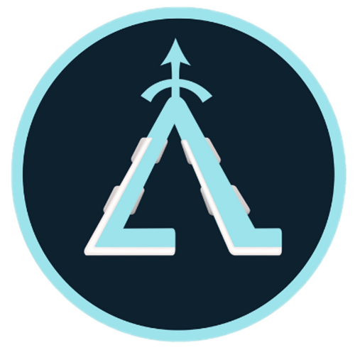

# 🦿 AQUILES - Exoesqueleto de Asistencia Motriz

  
  <h3>Revolucionando la movilidad humana</h3>
  
Exoesqueleto de asistencia motora con inteligencia artificial y control FOC

  

    &nbsp;
    &nbsp;
    &nbsp;
    &nbsp;
    
  

---

## 🌍 ¿Qué es AQUILES?

**AQUILES** es un exoesqueleto de asistencia motriz desarrollado por estudiantes de **Aviónica de la Escuela Técnica N.º 7 “IMPA” de Quilmes**, cuyo objetivo es **reducir la fatiga, mejorar la estabilidad y otorgar mayor autonomía** a personas con dificultades de movilidad.

El sistema combina **electrónica de control avanzada**, **inteligencia artificial adaptativa** y **una arquitectura de motores BLDC con control FOC**, optimizando la asistencia durante la marcha según el esfuerzo y ritmo del usuario.  
Incluye una **aplicación móvil y plataforma web** para el monitoreo, ajuste remoto y registro de datos clínicos en tiempo real.

---
## 🎬 Video Presentación

  
   
  <em>Ver en YouTube</em>

---
## 🧠 Propósito e Impacto

AQUILES busca democratizar el acceso a tecnologías de rehabilitación avanzadas y accesibles en Argentina y Latinoamérica.  
Su impacto se extiende en tres ejes principales:

- **Médico:** mejora la eficacia de procesos de rehabilitación neuromotriz.  
- **Social:** promueve la autonomía e inclusión de personas con movilidad reducida.  
- **Tecnológico:** posiciona al país como referente en robótica de asistencia y salud.

---

## ⚙️ Arquitectura del Sistema

### 🔩 Hardware
- **Microcontrolador principal:** ESP32-S3 (Wi-Fi, BLE, USB OTG, dual-core LX7 240 MHz).  
- **Drivers de motor:** módulos basados en **IR2104 + MOSFETs IRLR7843** controlados por **RP2040**.  
- **Motores:** BLDC con reductoras planetarias de 4 etapas.  
- **Sensores:**
  - Encoders magnéticos **AS5600 / AS5048A**.  
  - Sensores de corriente **ACS725**.  
  - IMU **MPU-6050**.  
- **Fuente de alimentación:** baterías Li-Po 3S 5000 mAh 70C.  
- **Estructura:** piezas en **PETG** con insertos metálicos y módulos intercambiables (Athena, Drive-M, Módulos motrices).

### 💻 Software
- **Lenguajes:** C, C++, Dart, HTML, JS.  
- **Firmware:** SimpleFOC, comunicación SPI entre ESP32-S3 y RP2040.  
- **App móvil:** desarrollada en **Flutter + Firebase**, con UI intuitiva para monitoreo y ajustes.  
- **Web:** [aquilesproject.com](https://aquilesproject.com) – presentación del ecosistema, galería, sponsors y contacto.

---

## 📱 Aplicación Móvil – *AquilesApp*

La app permite:
- Conectar el exoesqueleto vía BLE.  
- Ajustar el nivel de asistencia y sensibilidad.  
- Visualizar batería, torque y consumo en tiempo real.  
- Registrar sesiones de rehabilitación.  
- Generar informes automáticos para médicos y terapeutas.

Desarrollada en **Flutter**, con base de datos en **Firebase Firestore**, integración de **autenticación segura** y **almacenamiento en la nube**.

---

## 🦾 Módulos Principales

| Módulo | Descripción |
|--------|-------------|
| **Athena** | Núcleo de control. Alberga la mainboard, conectividad y algoritmo central. |
| **Drive-M** | Controladores locales con RP2040 + IR2104 + ACS725. |
| **Asistencia Motriz** | Transmisión de potencia con reductora planetaria 4 etapas. |
| **Aplicación** | Interfaz de control remoto y registro médico. |
| **Web** | Difusión, documentación y panel de desarrollo. |

---

## 🔋 Limitaciones y Próximos Pasos

### Limitaciones Actuales
- Autonomía limitada (≈45 min).  
- Calentamiento de motores en cargas elevadas.  
- Peso optimizable mediante nuevos materiales compuestos.

### Próximas Etapas
- Incorporación de **baterías modulares**.  
- Mejora del **control FOC con realimentación de corriente**.  
- Integración de **IA local** para detección de intención de paso.  
- Validación con pacientes y ensayos clínicos en centros de rehabilitación.

---

## 🧩 Stack Tecnológico

| Componente | Tecnología |
|-------------|-------------|
| **Microcontrolador** | ESP32-S3 (Espressif) |
| **Driver motor** | IR2104 + IRLR7843 |
| **Control local** | RP2040 |
| **Software embebido** | SimpleFOC, PlatformIO |
| **Aplicación móvil** | Flutter + Firebase |
| **Diseño mecánico** | Fusion 360 + impresión 3D PETG |
| **PCB** | EasyEDA Pro + KiCad |
| **Gestión** | Trello, Miro |

---

## 👨‍🔬 Equipo de Desarrollo

| Integrante | Contacto |
|-------------|-----------|
| **Juan Ignacio Montilla** | [GitHub](https://github.com/monti3) • [LinkedIn](https://www.linkedin.com/in/juan-ignacio-montilla-b98064358/) |
| **Santiago Alberto Zacarías** | [GitHub](https://github.com/ZaCoso) • [LinkedIn](https://www.linkedin.com/in/santiago-zacar%C3%ADas-3a3978319/) |
| **Juan Cruz Isola** | [GitHub](https://github.com/juanisola) • [LinkedIn](https://www.linkedin.com/in/juan-cruz-isola-11309035a/) |
| **Rodrigo Alexis Lin** | [GitHub](https://github.com/alexisrodrigolin) • [LinkedIn](https://www.linkedin.com/in/rodrigo-lin-61210a35b/) |
| **Mauricio Trillo Contardi** | [GitHub](https://github.com/MauricioTrillo) • [LinkedIn](https://www.linkedin.com/in/mauricio-trillo-contardi-68bbba35a/) |
| **Misael Castillo** | [GitHub](https://github.com/misaacastillo) • [LinkedIn](https://www.linkedin.com/in/misael-castillo-0a52a1314/) |

---

## 🙌 Agradecimientos

A los profesores **Diego Palmieri**, **Fabrizio Carlassara**, **Sergio Medina**, **Federico Solomiewicz**, **Carlos Bianco** y **Julián Scicolone** por su guía constante.  
Agradecemos también al **Centro Médico y de Rehabilitación del Sanatorio Modelo de Quilmes**, **Centro de Ojos Quilmes**, **Newton**, **Repuestos Santa Fe**, **La Amoladora Services**, **Ir3d**, **Mr Service**, **ElectroStar**, y **Decomontaje** por su apoyo técnico y material.

---

## 📜 Licencia

Este proyecto está bajo la licencia [MIT](LICENSE).  
© 2025 Aquiles Project — EEST N.º 7 “IMPA”, Quilmes.

---

> “AQUILES no es solo un proyecto tecnológico. Es una propuesta humana para devolver el movimiento, la autonomía y la esperanza.” 💪🦿
